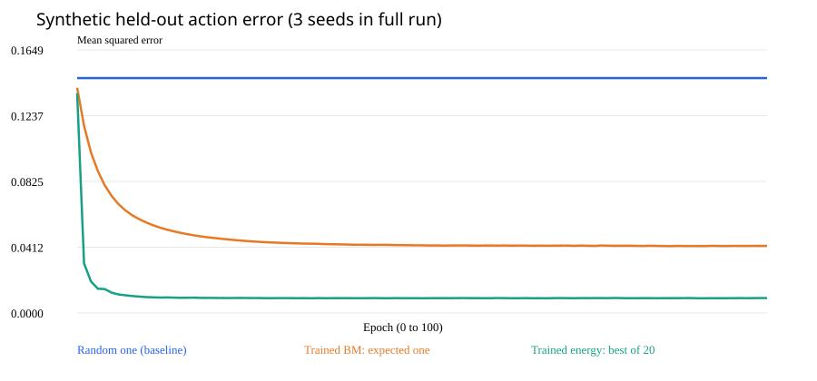
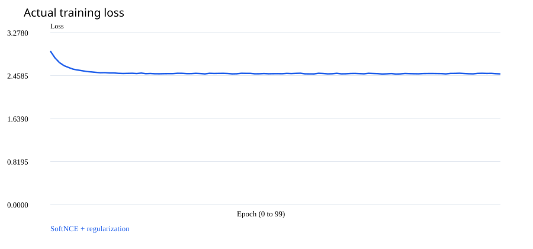

# 2026-11-19 条件 EBM 初始噪声学习：合成数据教学模拟实验

> 范围声明：本报告来自实际执行的 NumPy 小模型训练，数据为人工合成。未运行 π0.5、SmolVLA、Kaiwu、机器人仿真器或真实机械臂。不能用于证明这些系统性能提升。

## 1. 实验基本信息
### 1.1 实验目的与假设
验证在固定动作生成器下，条件 EBM 能否学习偏向低动作误差的初始噪声。假设为测试集期望动作 MSE 低于未训练的均匀噪声分布。任务是二维单步动作回归，不是抓取任务成功率实验。

## 2. 可追溯性三件套
### 2.1 代码版本
代码为本项目从零实现。精确文件指纹见 results/sha256.json。运行环境：Python 3.12.14、NumPy 2.3.5、arm64。源代码 src/train.py；不依赖 GPU。报告生成于 2026-11-19T12:34:09+08:00。
### 2.2 数据集
每个种子训练集 256 条、独立同分布测试集 256 条。随机种子 7、19、42。二维观察 c 均匀采自 [-1,1]。固定生成器 F(c,z)=c+0.35z。人工参考噪声为 [0.8c₁−0.5c₂, 0.6c₁+0.7c₂]，参考动作为 F(c,z*)。这是特意构造的简单可学习规律，不代表现实机器人数据。实际数据保存于 data/synthetic_*.npz；没有在测试集上训练，轮数预先固定为 100。
### 2.3 实验配置
每维噪声 3 bit，共 6 bit、64 种状态；二进制编码后作逆正态映射。条件二次能量包括 6 个线性项、15 个隐藏交互项、12 个条件交互项，共 33 个参数。每个观察每次训练使用 4 个当前模型样本和 16 个随机样本；batch=32；100 epochs；Adam 学习率 0.035；误差温度 0.5；能量温度 1；L2 系数 0.0001。精确配置见 results/config.json。

与视频/原代码的主要差异：用固定二维条件特征替代 Transformer，用固定解析生成器替代冻结 VLA，用 64 状态精确枚举采样替代 Kaiwu 模拟退火，没有 Replay Buffer、服务器通信或动作块执行。保留的是“冻结生成器评估候选 → 误差软标签 → 能量排序学习”的机制。

## 3. 训练过程记录
### 3.1 Training Curve
每个种子 800 次参数更新；逐轮实测记录见 results/training_*.csv。误差图对三个种子取均值，Loss 为训练批次平均值；epoch 0 尚未更新，因此没有 Loss。

### 3.2 过程异常与中断
系统默认 Python 缺少 NumPy，改用本机已有的隔离运行时执行。没有安装云端 SDK，没有登录或上传 SwanLab。三次训练均正常结束；墙钟训练时间合计 0.653 秒，不含环境准备。完成能量梯度有限差分校验（最大误差约 7.5e-11），种子 7 重跑所得参数和数值指标一致。

## 4. 实验结果
### 4.1 最终指标
以下数字是三个种子的均值。单候选指标为枚举所有状态所得精确期望，不是只抽一次后的偶然结果。

|方案|测试动作 MSE|说明|
|---|---:|---|
|未训练 BM，均匀分布|0.141171|单候选期望基线|
|训练后 BM|0.042106|同一状态空间的单候选期望|
|训练能量选 20 个随机候选之一|0.009340|额外选择预算，单独报告|
|64 状态参考动作 Oracle|0.001429|使用答案的不可部署下界|

### 4.2 与基线对比分析
同预算的单候选期望 MSE 降低 70.17%。该结论只适用于本合成任务。20 候选方案使用不同预算，不能将其额外收益全部归因于噪声分布学习。测试参考动作只用于统计误差，不用于实际能量选择；Oracle 明确使用参考答案，不作为可部署方案。没有把 MSE 换算为准确率或机器人任务成功率。

### 4.3 实验输出
#### 4.3.1 Training Artifacts
results/checkpoint_*.npz：参数；training_*.csv：逐轮记录；config.json：配置；summary.csv/json：各种子汇总；data/：数据快照。
#### 4.3.2 Inference Artifacts
results/inference_*.json：测试观察、参考动作、所选比特、噪声、预测动作与误差。两个 SVG 图可直接插入支持矢量图的软件，HTML 报告可浏览查看。

## 5. 结论与下一步
### 5.1 结论
在本合成任务上，条件 EBM 学到了比均匀噪声更低误差的分布，且可用低能量选择候选。这验证了一个简化机制，不验证 VLA 或 Kaiwu 的实际收益。
### 5.2 下一步
先由学习者复现现有结果；再观察单个样本；随后比较关闭条件、仅随机候选等消融。最后在获得真实环境和算力后适配冻结 VLA，并用相同推理预算评估真实仿真任务及延迟。
### 5.3 沉淀
已形成可运行源码、确定性合成数据、实测日志、检查点、推理样例、图表、复现说明和可选 SwanLab 日志上传脚本。

## 关联项目
长期目标：将 BF 的 EBM 思路接入冻结 π0.5。当前阶段：本地 CPU 原理教学原型。

## References
- 用户提供的腾讯会议《具身case 9.7》：https://meeting.tencent.com/crm/lRQWXJ9130 。视频知识点依据此前读取的自动纪要，未逐帧验证。
- 用户提供的 smolvla_ebm 代码：条件 BM、候选误差评估与 softNCE 实现。
- SwanLab：用户提供的接入示例；本项目上传实际 CSV，不采用公式伪造训练曲线。
